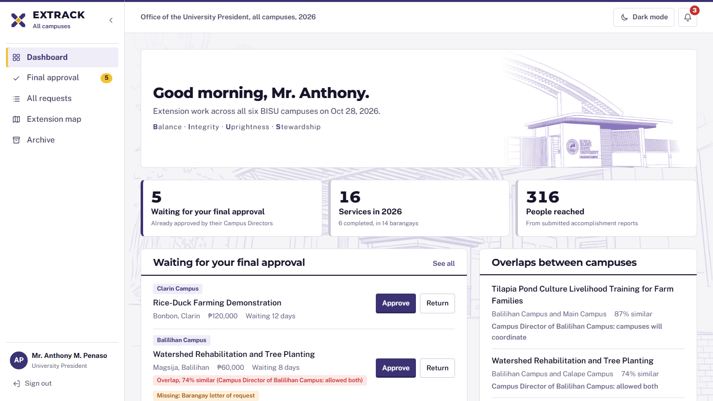
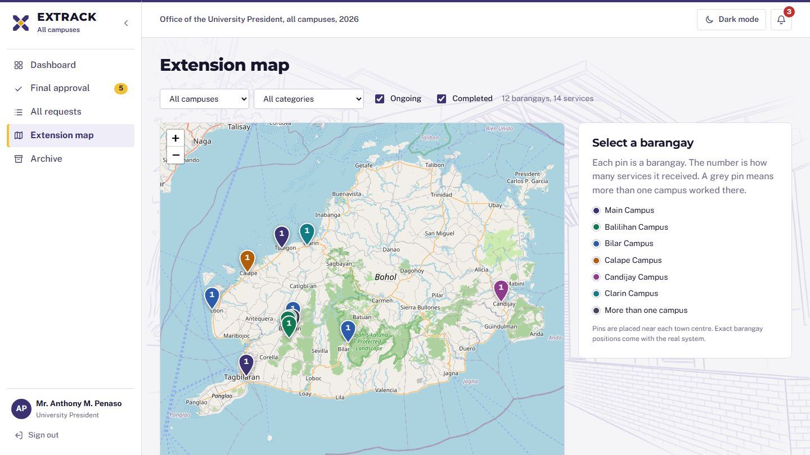

## Overview

Bohol Island State University runs extension services (community programs) across several campuses. EXTRACK is a prototype that tracks each service from the first request to the final report. Every approval step happens in one place, and the archive is shared between campuses.

## What I built

- **A three-level approval flow.** The Extension Director submits a request, the Campus Director approves, returns or declines it, and the University President gives final approval.
- **Five role dashboards.** Extension Director, Extension Assistant, Campus Director, Campus Assistant and President each see the screens their job needs. The President sees every campus.
- **Duplicate-work check.** While a director types a new request, EXTRACK searches every campus for similar services that were already done.
- **Accomplishment reports with photos.** Once a service is carried out, the director reports on it with photos. Submitting the report moves the request into the archive.
- **Archive with filters.** The President can filter the archive and remove records.
- **Maps.** Service locations are shown on a Leaflet map with OpenStreetMap tiles.

## How it works

A Laravel 13 app with a MySQL database. Filament 3 handles sign-in, and the dashboards are Blade views with Alpine.js for the interactive parts. Database seeders fill in the campuses, service categories and barangays, so a fresh install is ready to use.

Changes made in one role show up in the other dashboards within a few seconds, so a request can be walked through every step of the approval chain in one demo.

## What I'd improve

- The campus budget allocation feature is built but switched off. Requests show their proposed budget for information only.
- The demo has one login that switches roles. A real deployment needs a separate account for each person.
- It runs locally only. Hosting it would let the campuses try it with real requests.

## What I learned

> Mapping the real approval chain first (who submits, who approves and who can send a request back) made the database and the screens much simpler to build.
